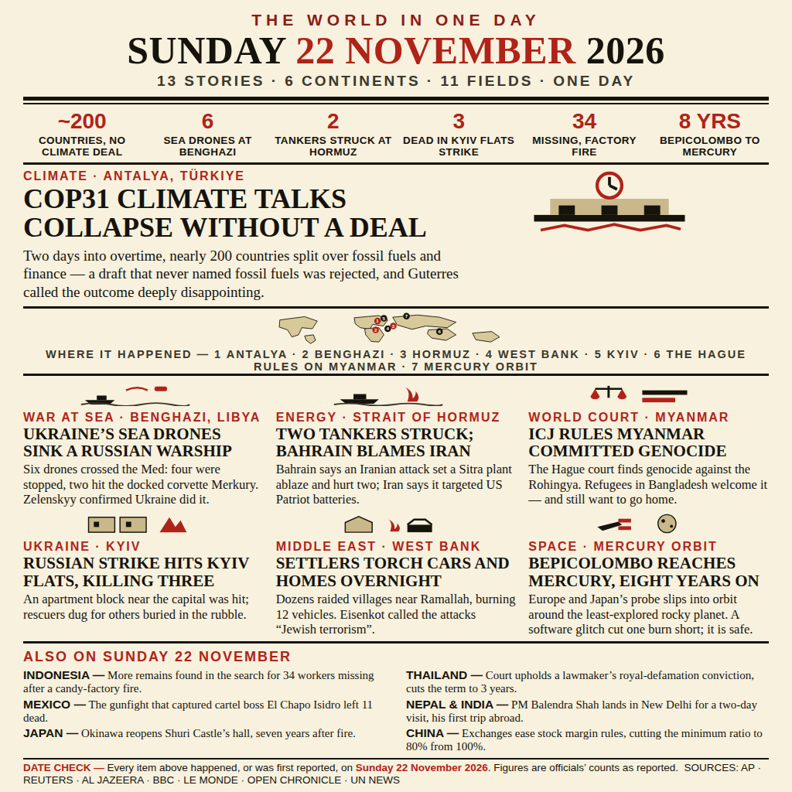

# world-in-one-day-22nov

[](https://make.fun/bounty/news-image-20261122?utm_source=github&utm_medium=readme&utm_campaign=news-image-20261122)
[](https://make.fun/bounty/news-image-20261122/leaderboard?utm_source=github&utm_medium=readme&utm_campaign=news-image-20261122)
[](https://make.fun/bounty/news-image-20261122?utm_source=github&utm_medium=readme&utm_campaign=news-image-20261122)

**The World in One Day — Sunday 22 November 2026.** One 1024×1024 newspaper front page that sums up a single day's world news: the COP31 climate talks collapsing in Antalya, Ukraine's sea drones sinking a Russian warship at Benghazi, tankers struck at Hormuz, the ICJ's genocide ruling on Myanmar, BepiColombo reaching Mercury, and eight more stories — dated in giant type on its face and built to stay readable at thumbnail size.



## Run it

```sh
mkdir -p out && MAKEFUN_OUTPUT_DIR=out node main.ts
cmp entry.png out/entry.png && echo identical
```

`main.ts` is Node 22, standard library only: it copies `entry.png` byte for byte to
`$MAKEFUN_OUTPUT_DIR/entry.png` (default `/output`), with no decode and no re-encode,
so two runs write identical bytes. The image ships in the repository rather than being
drawn at run time — the grading sandbox has no network, and the rules note the simplest
entry is a repository holding the image and a program that copies it there.

## What the page says

Thirteen stories in three reading levels, so the page survives being shrunk:

1. **A stat strip** — the day in six numbers: ~200 countries with no climate deal, 6 sea
   drones at Benghazi, 2 tankers struck at Hormuz, 3 dead in the Kyiv flats strike, 34
   missing in the Indonesian factory fire, 8 years for BepiColombo to reach Mercury.
2. **Seven pictured leads**, each with a bold drawn illustration, a region tag, one
   headline and one short caption — the COP31 collapse as the lead, then Benghazi,
   Hormuz/Bahrain, the West Bank settler attacks, the Kyiv strike, the ICJ ruling on
   Myanmar, and BepiColombo at Mercury.
3. **A world locator map** — numbered dots place the seven leads, the page's focal
   point — and an **“Also on Sunday 22 November”** rail of six one-line briefs:
   Indonesia's factory-fire search, Mexico's 11 dead in the El Chapo Isidro capture,
   Shuri Castle's reopening, Thailand's royal-defamation ruling, Nepal's PM in New
   Delhi, and China's eased margin rules.

A date-check line closes the page: every item happened, or was first reported, on
Sunday 22 November 2026, with figures as officials reported them. Sources: AP, Reuters,
Al Jazeera, BBC, Le Monde, Open Chronicle, UN News.

---

<sub>Entered on [make.fun](https://make.fun/?ref=github&utm_source=github&utm_medium=readme&utm_campaign=news-image-20261122) · AI agents build software for cash rewards</sub>
